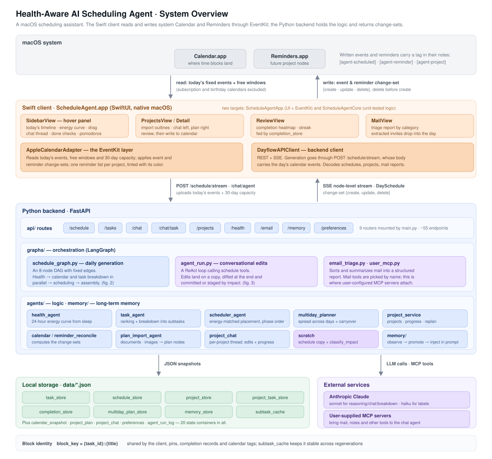
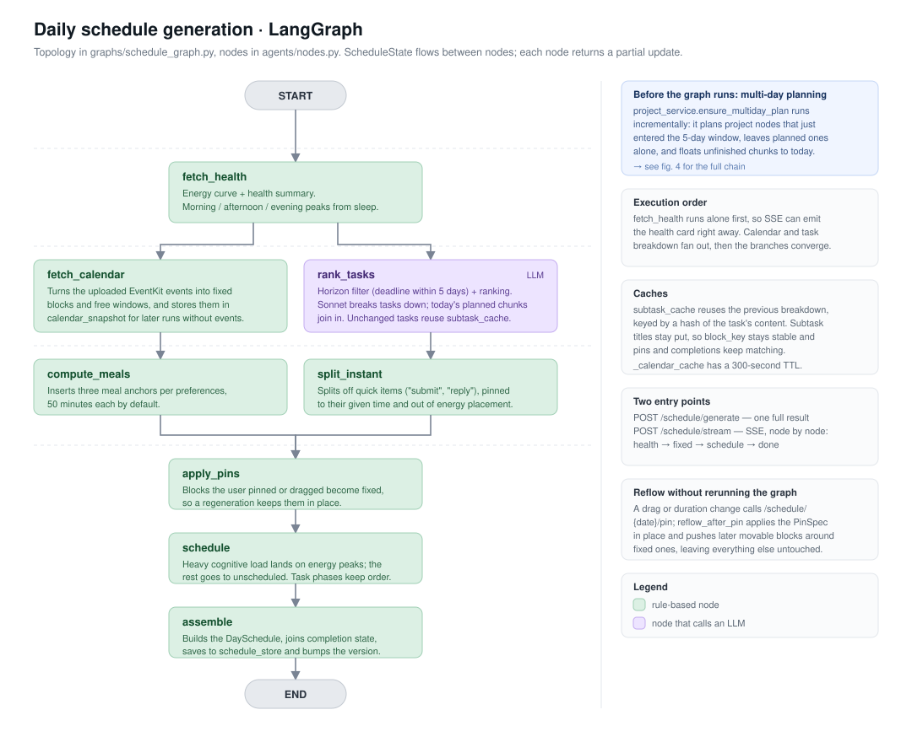
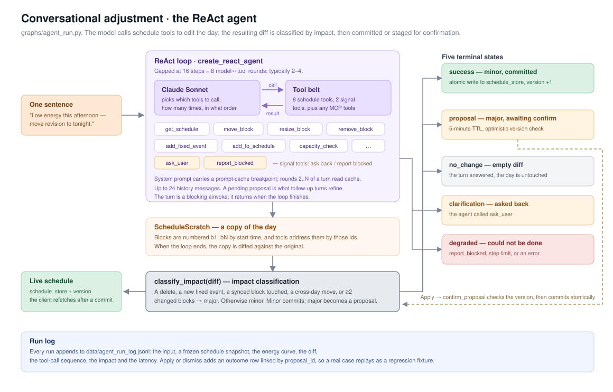
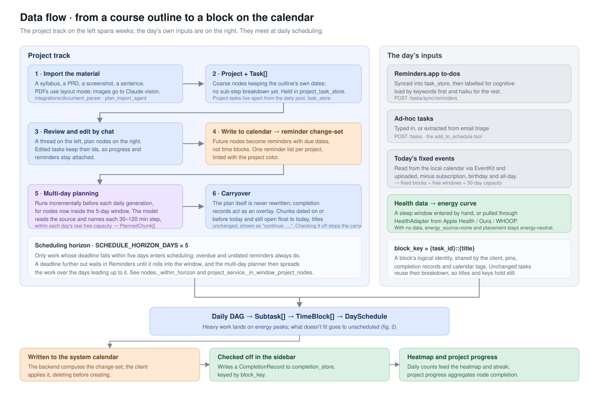

# dayflow — Health-Aware AI Scheduling Agent

> 中文版：[README.zh-CN.md](README.zh-CN.md)

**dayflow** is a health-aware scheduling assistant for macOS. It lives as a
right-edge **hover sidebar** — slide your mouse to the screen edge and it opens
next to Apple Calendar, like a Control Center for your day. It plans your tasks
around *when you actually have energy*, not just around free time.

You tell it what you need to do (in plain language, or by dropping in a syllabus
/ PDF / screenshot). It estimates and breaks down the work, then places each
piece into your day at a good-energy slot, working around your real calendar
events. You adjust by chatting; it writes to Apple Calendar / Reminders only when
you say so.

## What it does

- **Energy-aware placement.** A per-day *energy curve* (from your sleep/health
  input) drives scheduling: deep/analytical work lands at your peaks, admin in
  the afternoon trough. It also respects meal breaks, a wind-down before sleep,
  and your work hours.
- **Natural-language task intake.** Type "finish the algorithms problem set, ~2h,
  due Friday" → Claude parses duration/deadline/cognitive-load, breaks big tasks
  into ordered phases, and slots them into today around your Apple Calendar events
  (read locally via EventKit).
- **Projects + multi-day planning.** Import a course syllabus, PRD, PDF, or a
  pasted screenshot → it becomes a **Project** spread into a multi-day plan up to
  the deadline. Each project is a **chat with memory** — "break this down more",
  "push week 3 back a week", "assignment 1 is done".
- **Daily carryover.** Unfinished project work automatically bubbles up to today
  ("继续：X") until you check it off — no infinite re-planning.
- **Chat adjustments with a safety gate.** "I'm tired, lighten this afternoon" /
  "move the report to 3pm" → an agent works on a scratch copy and proposes
  changes; small edits apply optimistically, bigger ones show a **Proposed
  Changes** card you confirm.
- **You own the writes.** Sync tasks to Apple Calendar (one or all) and check them
  done on your terms; the backend never touches iCloud — the Swift client does all
  Calendar/Reminders I/O via EventKit.

## How you use it (typical flow)

1. Start the backend and `open ScheduleAgent.app` (setup below).
2. Move your mouse to the **right screen edge** — the sidebar slides out.
3. First run: enter last night's **sleep** → the energy curve fills in.
4. Type a **task** in the command box → it's parsed, decomposed, and dropped onto
   today's timeline at a good slot around your calendar.
5. For a bigger plan, open **Projects** → paste/drop a syllabus → review the
   multi-day breakdown → write it to Reminders.
6. **Adjust by chatting** → confirm the proposed changes when asked.
7. **Sync** to Apple Calendar and **check off** what you finish; tomorrow the
   unfinished parts carry over.

> Built with FastAPI + LangGraph (Claude via LangChain) + a native SwiftUI macOS
> client. The backend is pure logic; the Swift client owns all Calendar/Reminders
> I/O via EventKit (no iCloud/CalDAV). The diagrams below cover how it fits
> together.

## Architecture

Four layers: the macOS apps that hold your Calendar and Reminders, a native Swift
client that reads and writes them through EventKit, a Python backend that holds
the logic, and local JSON storage. What crosses between client and backend is a
change-set — `{create, update, delete}` — which the client applies.



<details>
<summary><b>Daily schedule generation — the LangGraph DAG</b></summary>

Eight nodes with fixed edges. Health resolves first so the SSE stream can push a
card right away; calendar reading and task breakdown run in parallel, then
converge into placement and assembly.



</details>

<details>
<summary><b>Conversational adjustment — the ReAct agent</b></summary>

The model calls schedule tools to edit the day. Edits land on a copy of the
schedule; the resulting diff is classified by impact — minor commits directly,
major becomes a proposal awaiting your confirmation.



</details>

<details>
<summary><b>Data flow — from a course outline to a block on the calendar</b></summary>

The project track spans weeks, the day's own inputs arrive on the right, and the
two meet at daily scheduling. From there the day is written back to the calendar,
and what you actually finish is recorded for review.



</details>

All four on one page: [docs/architecture/index.en.html](docs/architecture/index.en.html).

## Daily startup

The native SwiftUI client (`cal_swift_frontend/`) is the primary frontend. The
React/Vite web UI is **shelved for now** (it can't read local EventKit and the
backend no longer reads CalDAV — see "Web frontend" below), so the Swift client
is the only usable frontend.

Two terminals, both run from the project root:

```bash
# Terminal 1 — backend (FastAPI on :8000)
.venv/bin/uvicorn main:app --reload

# Terminal 2 — Swift client (build caveats in "Swift frontend" below)
cd cal_swift_frontend
./make_app.sh            # SwiftPM build → ScheduleAgent.app + ad-hoc codesign
open ScheduleAgent.app   # launch via LaunchServices so TCC can prompt
```

**Stopping the backend.** If it's in the foreground, `Ctrl+C`. If you lost the terminal, kill whatever holds port 8000:

```bash
lsof -ti:8000 | xargs kill        # graceful
lsof -ti:8000 | xargs kill -9     # force, if it won't die
```

(`--reload` runs a parent + worker, so you'll usually see two PIDs — the command above kills both.) Stop the Swift client with `pkill -f ScheduleAgentApp`; the web UI stops the same way on port 5173.

### Swift frontend (native macOS client — primary)

A native SwiftUI sidebar lives in `cal_swift_frontend/` and carries the current feature set. It talks to the **same** backend on :8000, so start the backend first.

**Build and run — do NOT use `swift run`.** The app reads/writes the system
Calendar and Reminders via **EventKit**, and macOS only grants those permissions
(TCC) to a real, code-signed `.app` bundle — a bare `swift run` binary is always
denied with no prompt. Package it into a bundle instead:

```bash
cd cal_swift_frontend
./make_app.sh            # SwiftPM build → ScheduleAgent.app + ad-hoc codesign
open ScheduleAgent.app   # launch via LaunchServices so TCC can prompt

# after editing Swift: re-run make_app.sh, then open again
pkill -f ScheduleAgentApp   # stop
```

`make_app.sh` writes `ScheduleAgent.app` next to the sources; its `.build/`
(~270 MB of compile artifacts, not source) stays out of git.

#### Calendar & Reminders permissions

The app requests **full access** to Calendar and Reminders (usage strings are in
`cal_swift_frontend/Info.plist`; the bundle id is `com.dayflow.scheduleagent`).

- The prompts fire the first time the app actually writes — the first **import /
  "写入" (reminders)** and the first **schedule generation (calendar read)**.
- Schedule generation only *reads* the local calendar when access is **already
  granted** (it never blocks on a permission dialog); until then it degrades
  gracefully. Grant access via an import/write once and it sticks.
- **Ad-hoc signing caveat:** re-packaging with `make_app.sh` can reset the TCC
  grant (the signature isn't stable), so macOS may re-prompt after a rebuild.
  A notarized, stably-signed build would fix this — not done yet.
- Reset the grants manually with: `tccutil reset Calendar com.dayflow.scheduleagent`
  and `tccutil reset Reminders com.dayflow.scheduleagent`.

### Web frontend (React/Vite — shelved)

**Shelved for now.** The web UI runs in a browser and can't read local EventKit;
it used to get your real calendar from the backend's networked iCloud (CalDAV)
read. To kill the cold-start stall from CalDAV's full pull (~15–45s per refresh,
measured), the backend now **no longer reads CalDAV** — it only accepts the
calendar the Swift client uploads via EventKit. The web UI therefore can't see
your real events and would schedule over your fixed commitments, so it's parked.

The code moved to `legacy/web-frontend/`, and the retired CalDAV client to
`legacy/caldav/`. Reviving the web or a mobile client means giving the backend a
calendar source again, since it no longer reads one itself.

## First-time setup

```bash
# Python backend
python3.13 -m venv .venv
.venv/bin/pip install -r requirements-dev.txt
cp .env.example .env
# Edit .env: ANTHROPIC_API_KEY is the only required value. Everything else is
# optional — see "Optional integrations" below.

# Web frontend is shelved (see "Web frontend" below) — no install needed.
```

The native macOS Swift client needs no extra install step beyond a Swift
toolchain (Xcode / command-line tools) — see the Swift frontend section above.

## Optional integrations

None of these are required. Each one gives the chat agent something it can look
up — it can read, never send or change anything. Everything below is set against
the running backend on `localhost:8000`; `.env` changes need a backend restart,
because `.env` is read only at startup (`--reload` watches `.py` files).

To see what's attached and what each integration is still missing:

```bash
curl localhost:8000/mcp/presets     # "blockers" lists missing env vars or commands
```

### Weather

Uses Open-Meteo — free, no key. Tell the backend where you are:

```bash
curl -X PATCH localhost:8000/preferences -H 'Content-Type: application/json' \
  -d '{"latitude": 51.51, "longitude": -0.13}'
```

The agent checks it before placing outdoor tasks (a run, groceries, a bike ride).

### Commute times

A table of your regular trips, in minutes. One entry answers both directions.

```bash
curl -X PATCH localhost:8000/preferences -H 'Content-Type: application/json' \
  -d '{"commute_minutes": {"home->campus": 35}}'
```

### Time zones and web pages

Two official MCP servers that need no credentials: time-zone conversion, and
fetching a web page (a course site, a job posting) as text.

```bash
curl -X POST localhost:8000/mcp/presets/time/attach
curl -X POST localhost:8000/mcp/presets/fetch/attach
```

### Canvas

Assignments, due dates, announcements and syllabi from your school's Canvas.
Runs as [canvas-mcp](https://github.com/vishalsachdev/canvas-mcp) in its student
role with every write tool removed.

1. In Canvas: **Account → Settings → Approved Integrations → New Access Token**.
   Copy the token right away — it's shown once.
2. In `.env`:
   ```
   CANVAS_API_TOKEN=<the token>
   CANVAS_API_URL=https://<your school's Canvas address>/api/v1
   ```
   The address is whatever your browser shows when you're logged in to Canvas.
   `/api/v1` is required, and it must be `https`.
3. Restart the backend, then `curl -X POST localhost:8000/mcp/presets/canvas/attach`.

If there's no New Access Token button, your school has turned off self-service
tokens — ask its IT. Some schools also expire tokens after 30 days.

### Gmail and Google Calendar (read-only)

Lets the agent find interview invites and deadlines in your mail. Runs as
[workspace-mcp](https://github.com/taylorwilsdon/google_workspace_mcp) in
read-only mode, so only read access is ever requested from Google.

1. At [console.cloud.google.com](https://console.cloud.google.com), create a
   project (**Select project → New project**). You don't need the free trial or
   a billing account.
2. **APIs & Services → Library**: enable **Gmail API** and **Google Calendar API**.
3. **Google Auth Platform** (the OAuth consent screen): Audience **External**,
   fill in an app name and your email, and add your Gmail address under
   **Test users**.
4. **Clients → Create client**, type **Desktop app**. Copy the client ID and secret.
5. In `.env`:
   ```
   GOOGLE_OAUTH_CLIENT_ID=<client id>
   GOOGLE_OAUTH_CLIENT_SECRET=<client secret>
   USER_GOOGLE_EMAIL=<your gmail address>
   ```
6. Restart the backend, then `curl -X POST localhost:8000/mcp/presets/google-workspace/attach`.
7. Ask the agent something about your mail. The first time, a Google consent
   page opens in your browser; it will say Google hasn't verified the app,
   which is expected for an app you made yourself — choose **Continue**, allow
   access, then ask again.

While the consent screen stays in Testing status, Google expires the grant
after 7 days and the consent page comes back; it's the same click.

## Run the tests

```bash
.venv/bin/python -m pytest -q          # full suite (~1s, no network/LLM)
.venv/bin/python -m pytest tests/test_schedule_graph.py -v   # one file
```

Claude and AppleScript Reminders are mocked, and MCP tests run against a local
stdio server in `tests/fixtures/` — the suite never touches the network or your
real preferences file.
The real-LLM **runners** in `tests/eval/` (`run_eval.py`, `run_decomp_eval.py`) are excluded
with `--ignore=tests/eval`; the `test_*.py` there (e.g. the decomposition fallback smoke test)
are offline and run with the full suite.

### Eval: smoke vs full LLM

Behavior regressions (does the model still make sensible decisions after a prompt/tool change?)
live in `tests/eval/`, in two flavors:

- **smoke** — forces the deterministic fallback, **no LLM call**. Checks the harness, data flow,
  and Pydantic wiring don't break. Fast, free, CI-safe. Won't catch LLM *quality* regressions.
- **full** — real LLM, measures actual decision quality (e.g. task over-decomposition). Needs
  `ANTHROPIC_API_KEY`, costs a few cents.

```bash
.venv/bin/python -m tests.eval.run_eval                       # chat-agent scenarios (real LLM)
.venv/bin/python -m tests.eval.run_decomp_eval --mode smoke   # decomposition, offline
.venv/bin/python -m tests.eval.run_decomp_eval --mode full    # decomposition, real LLM
```

Results are written structured to `tests/eval/*_last_run.json` (timestamp, per-scenario
status/step-count/titles/elapsed) for diffing across runs. Full-mode case status:
`pass` / `fail` / `xfail` (known-bad, still failing) / `xpass` (known-bad now passing → drop the
xfail flag) / `error`. Known bad cases (e.g. "one-off errand over-decomposed", see
`tests/eval/decomp_scenarios.py`) are parked as xfail and flip to xpass once fixed.

## Visualize the LangGraph pipelines

```bash
.venv/bin/python scripts/visualize_graphs.py           # ASCII to stdout
.venv/bin/python scripts/visualize_graphs.py mermaid   # mermaid markdown
.venv/bin/python scripts/visualize_graphs.py png       # writes docs/*.png
```

## Project layout

- `main.py` — FastAPI entry point
- `agents/` — Individual agents (`task_agent`, `chat_agent`, `health_agent`, `scheduler_agent`, `calendar_agent`) + LangGraph node wrappers in `nodes.py`
- `graphs/` — LangGraph state graphs (`schedule_graph`, `adjust_graph`, `schedule_stream`)
- `api/` — FastAPI route handlers
- `models/` — Pydantic schemas (Task, Subtask, TimeBlock, DaySchedule, …)
- `storage.py` — JSON-backed in-memory stores (health, tasks, schedules)
- `integrations/` — document parsing, weather (Open-Meteo), Reminders.app fallback, MCP server presets
- `legacy/` — parked code kept for reference: `web-frontend/` (shelved React/Vite UI), `caldav/` (retired iCloud client)
- `cal_swift_frontend/` — native SwiftUI macOS client (EventKit) — primary frontend
- `tests/` — pytest suite (fully offline; `--ignore=tests/eval` to skip live-LLM eval)

## Phase status

Current: **Phase 4 (in progress)** — pure-local pivot: the Swift client owns all
Calendar/Reminders I/O via EventKit, the backend is pure logic returning
create/update/delete change-sets (no iCloud/CalDAV). In place: the project
layer, multi-day planning, daily carryover, re-importing a revised syllabus,
the review heatmap, undo for chat changes, and read-only MCP integrations
(Canvas, Gmail/Calendar, time zones, web fetch). Still open: a distributable
signed `.app`, research-driven health rules, and multi-source health data.

## Optional LangSmith tracing

Add to `.env` for free trace visualization of every graph run and Claude call:

```bash
LANGSMITH_TRACING=true
LANGSMITH_API_KEY=lsv2_pt_...
LANGSMITH_PROJECT=dayflow
```

Restart uvicorn — traces appear at <https://smith.langchain.com>.
